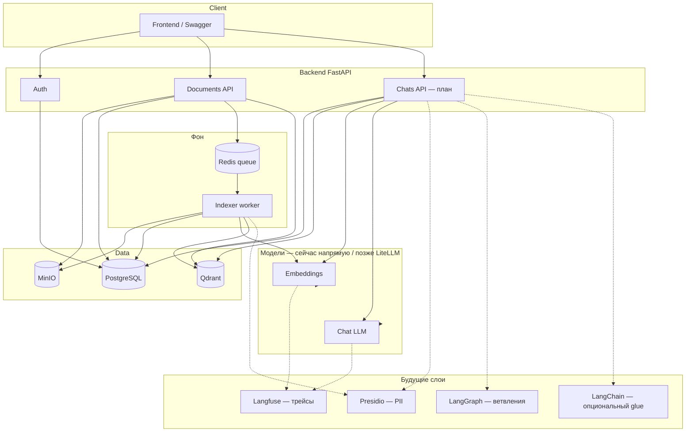

# Архитектура

Схема «клиент ↔ система»: [system-interaction.md](./system-interaction.md).  
Общий пайплайн (as-is / to-be): ниже и в том же файле (sequence-диаграммы).

## Цель продукта

Чат-бот по правовым документам: ответы опираются на загруженную базу знаний (RAG), а не на «общие знания» модели.

## Роли

| Роль | Сейчас / план |
|------|----------------|
| `user` | чат (свои диалоги) |
| `admin` | чат + загрузка / список / удаление документов |

Auth: access JWT (короткий) + refresh (БД) + httpOnly cookies; logout с blacklist access в Redis.

## Стек

| Компонент | Роль |
|-----------|------|
| FastAPI | HTTP API |
| PostgreSQL | users, chats, messages, documents, текст чанков, refresh_tokens |
| Qdrant | эмбеддинги чанков, similarity search |
| MinIO | исходные файлы (PDF/DOCX/TXT) |
| Redis | очередь индексации; blacklist access; позже кеш ответов |
| Worker | `make worker` — индексация документов |
| LLM / Embedding API | через HTTP (сейчас); позже LiteLLM → OpenAI / Ollama / … |

## Общий пайплайн

### A. Индексация документа (реализовано)

1. Admin: `POST /documents` (файл).
2. API: файл → MinIO; метаданные → Postgres (`pending`); job → Redis.
3. Worker:
   - скачать из MinIO;
   - извлечь текст;
   - *(позже: Presidio)*;
   - нарезать чанки;
   - эмбеддинги (сейчас HTTP API; *позже LiteLLM*);
   - текст чанков → Postgres;
   - вектора + payload → Qdrant;
   - статус `ready` / `failed`.
4. Удаление: Postgres (+ cascade чанков) + Qdrant по `document_id` + MinIO.

### B. Чат с RAG (план)

1. User/Admin: сообщение в чат.
2. Сохранить user-message в Postgres.
3. Embedding вопроса → top-k в Qdrant.
4. Prompt: system («только по контексту») + чанки + последние N сообщений.
5. *(позже: Presidio на входе/контексте; Langfuse на generation; при сложной логике — LangGraph)*.
6. LLM → ответ + sources → Postgres → клиент.

## Хранилища: зачем разделены

- **MinIO** — бинарники.
- **PostgreSQL** — транзакционные данные и текст чанков (удобно JOIN / аудит).
- **Qdrant** — быстрый векторный поиск; не смешиваем с OLTP.
- **Redis** — эфемерное: очередь, blacklist токенов, кеш.

## Будущие инструменты (дорожная карта)

| Инструмент | Зачем в этом проекте | Когда |
|------------|----------------------|--------|
| **LiteLLM** | единый слой OpenAI / Ollama / другие для embed + chat | сразу после чата или при переходе на Ollama |
| **Langfuse** | трейсы промптов, latency, стоимость, отладка ответов | когда чат заработает |
| **Presidio** | PII в логах / промптах / (опционально) индексе | когда появятся чувствительные данные и логи LLM |
| **LangGraph** | ветвления: уточнение, отказ без контекста, проверка цитат | когда линейного RAG мало |
| **LangChain** | опциональный glue retriever/prompt; не фундамент | по желанию, не блокирует MVP |

Порядок внедрения: **чат/RAG → LiteLLM → Langfuse → Presidio → LangGraph → (опц.) LangChain**.

## Статус модулей

| Модуль | Статус |
|--------|--------|
| Health, config, Docker (PG/Redis/MinIO/Qdrant) | есть |
| Auth (register/login/refresh/logout, cookies) | есть |
| Documents CRUD + очередь + worker индексации | есть |
| Chats + RAG answer | план |
| LiteLLM / Langfuse / Presidio / LangGraph / LangChain | план |

## Контракт для фронта

- Живой API: `/docs`, `/openapi.json` на запущенном бекенде.
- Офлайн-снимок: [api/](./api/) (GitHub Pages) — обновляется `make openapi` / CI.
