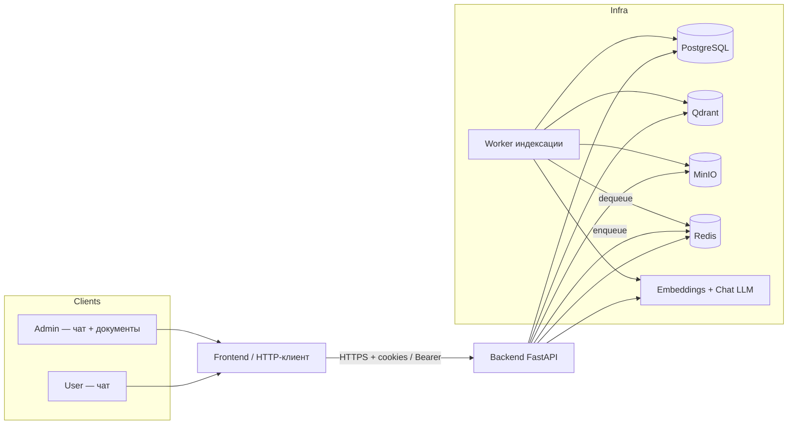
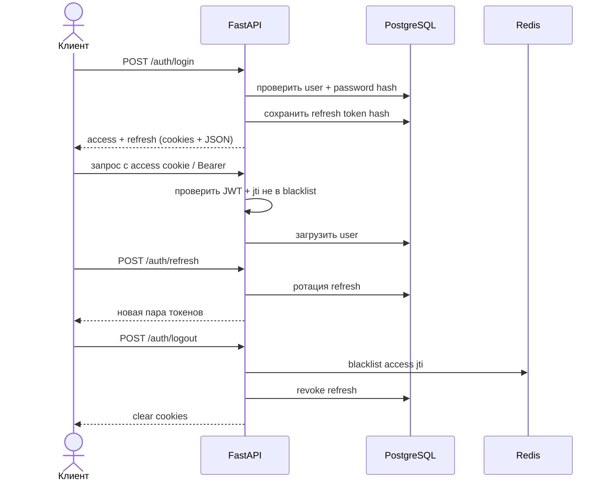
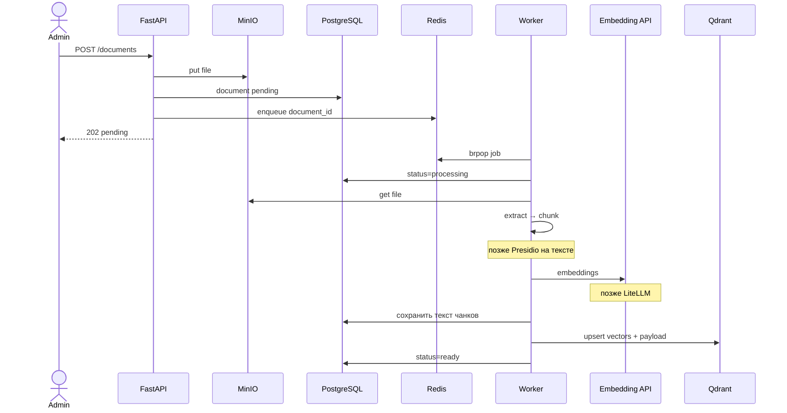
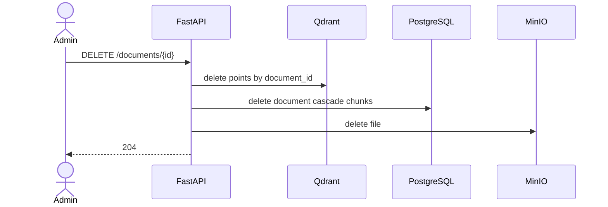
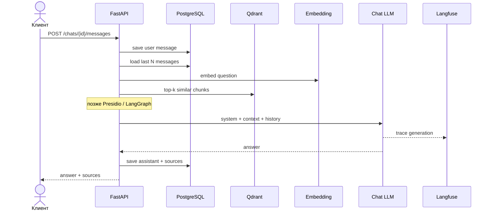

# Схема взаимодействия системы

Проектные документы (не правовые). Клиент ↔ бекенд ↔ инфраструктура, роли и потоки.

Архитектура и дорожная карта инструментов: [architecture.md](./architecture.md).

## Роли

| Роль | Возможности |
|------|-------------|
| `user` | Свои чаты и сообщения (когда чат будет). |
| `admin` | Всё, что `user`, плюс загрузка / список / удаление документов и статусы индексации. |

Auth (как сделано):

- login → access JWT (короткий) + refresh (hash в Postgres);
- httpOnly cookies + опционально JSON/Bearer;
- refresh с ротацией; logout → revoke refresh + blacklist access `jti` в Redis.

Правила:

- чат → `user` или `admin`;
- `POST/GET/DELETE /documents` → только `admin`;
- `GET /health` → публично.

---

## Общая картина

> Картинка выше историческая (ещё с pgvector). Актуальная схема — mermaid ниже и [architecture.md](./architecture.md).

Кратко:

- клиент говорит **только** с API;
- **Postgres** — пользователи, сессии refresh, документы, текст чанков, чаты;
- **Qdrant** — вектора и поиск;
- **MinIO** — файлы;
- **Redis** — очередь индексации + blacklist access;
- **Worker** — парсинг → чанки → embed → PG + Qdrant;
- **LLM** — сейчас HTTP API; позже через LiteLLM (OpenAI/Ollama/…).

---

## Поток: аутентификация

---

## Поток: загрузка документа (admin) — реализовано

---

## Поток: удаление документа (admin) — реализовано

---

## Поток: чат + RAG (план)

---

## Матрица API ↔ роли

| Эндпоинт | user | admin | Статус |
|----------|:----:|:-----:|--------|
| `POST /auth/register\|login\|refresh\|logout` | ✓ | ✓ | есть |
| `GET /auth/me` | ✓ | ✓ | есть |
| `POST/GET/DELETE /documents` | — | ✓ | есть |
| чаты / сообщения | ✓ | ✓ | план |
| `GET /health` | публично | публично | есть |

---

## Границы клиента

Фронт:

- login/refresh/logout с `credentials: 'include'` (cookies);
- UI чата и (admin) документов;
- опрос статуса индексации или SSE позже;
- OpenAPI: живой `/openapi.json` или снимок на Pages [`api/`](./api/).

Фронт не ходит в Postgres / Qdrant / MinIO / Redis / LLM напрямую.
