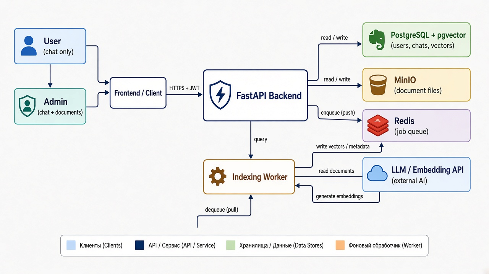
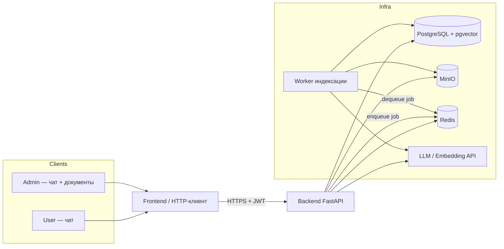
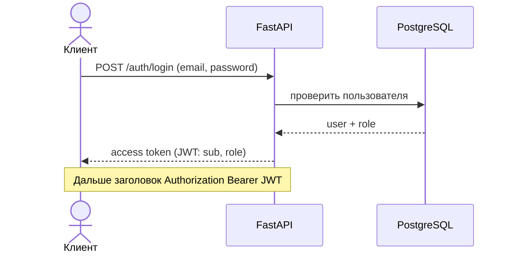
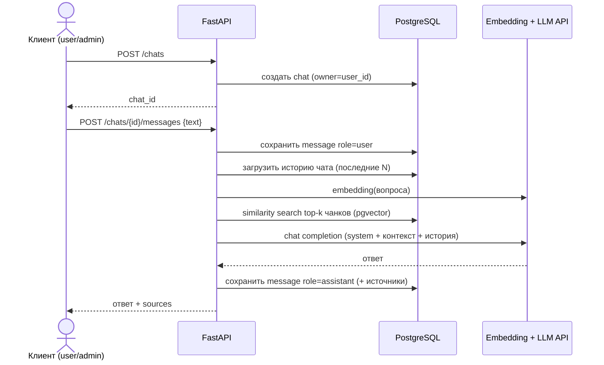
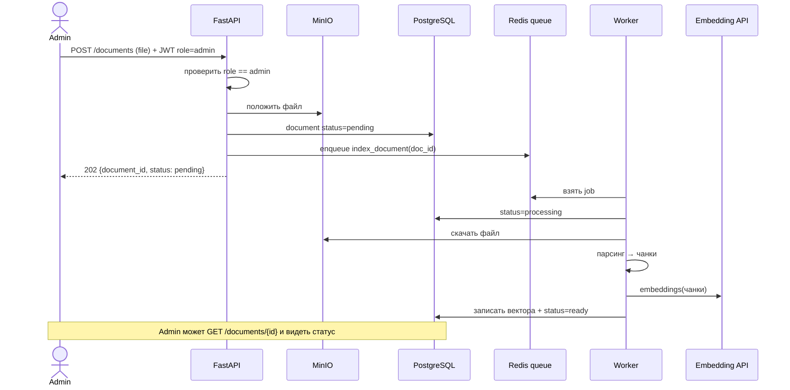
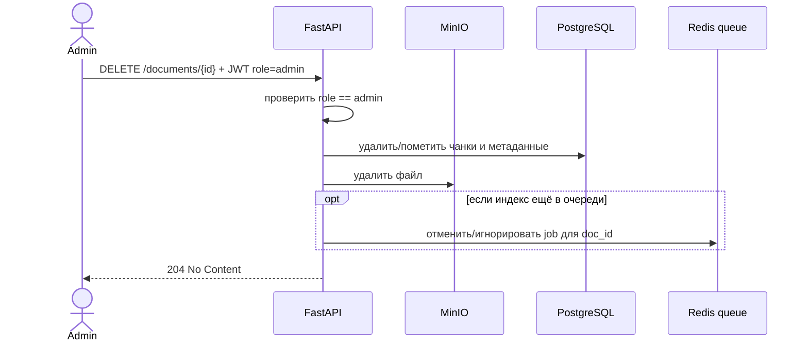

# Схема взаимодействия системы

Проектные документы (не правовые). Ниже — как клиент связан с бекендом и инфраструктурой, с учётом ролей.

## Роли

| Роль | Возможности |
|------|-------------|
| `user` | Чаты: создавать, читать свои, писать сообщения, получать ответы бота. Просмотр списка документов **только для справки** (без загрузки/удаления) — по желанию продукта; по умолчанию **чатится**. |
| `admin` | Всё, что `user`, плюс: загрузка документов, удаление документов, просмотр статусов индексации. |

Авторизация (черновик): клиент логинится → получает токен (JWT) с `role` → каждый защищённый эндпоинт проверяет роль.

Минимальные правила доступа:

- Чат-эндпоинты → `user` или `admin`
- `POST/DELETE /documents` → только `admin`
- `GET /documents` → `admin` (управление); для `user` можно закрыть или дать read-only список названий — решить на продукте

---

## Общая картина (контекст)

Кратко:

- **Клиент** говорит только с API (через фронт или напрямую).
- **Postgres** — пользователи, роли, чаты, сообщения, метаданные документов, вектора чанков.
- **MinIO** — исходные файлы.
- **Redis** — очередь задач индексации (+ позже кеш).
- **Worker** — отдельный процесс: забирает job из Redis, строит RAG-вектора.
- **LLM API** — эмбеддинги и генерация ответа.

---

## Поток: аутентификация

---

## Поток: чат (user и admin)

Клиент **не** ходит в Postgres/Redis/LLM напрямую — только в API.

---

## Поток: загрузка документа (только admin)

---

## Поток: удаление документа (только admin)

Удаление должно убирать и файл, и вектора — иначе бот продолжит опираться на «удалённый» документ.

---

## Матрица API ↔ роли (черновик)

| Эндпоинт | user | admin |
|----------|:----:|:-----:|
| `POST /auth/login` | ✓ | ✓ |
| `POST /chats`, сообщения, история своих чатов | ✓ | ✓ |
| `GET /documents` (список / статусы) | — | ✓ |
| `POST /documents` | — | ✓ |
| `DELETE /documents/{id}` | — | ✓ |
| `GET /health` | публично | публично |

`user`, вызвавший admin-эндпоинт → `403 Forbidden`.

---

## Границы ответственности клиента

Клиент (фронт):

- логин, хранение токена;
- UI чата и (для admin) UI документов;
- опрос статуса документа после загрузки (`pending` → `ready` / `failed`), либо позже — websocket/SSE.

Клиент **не** реализует RAG, не пишет в MinIO/Postgres и не зовёт LLM — это всё за API и worker.
